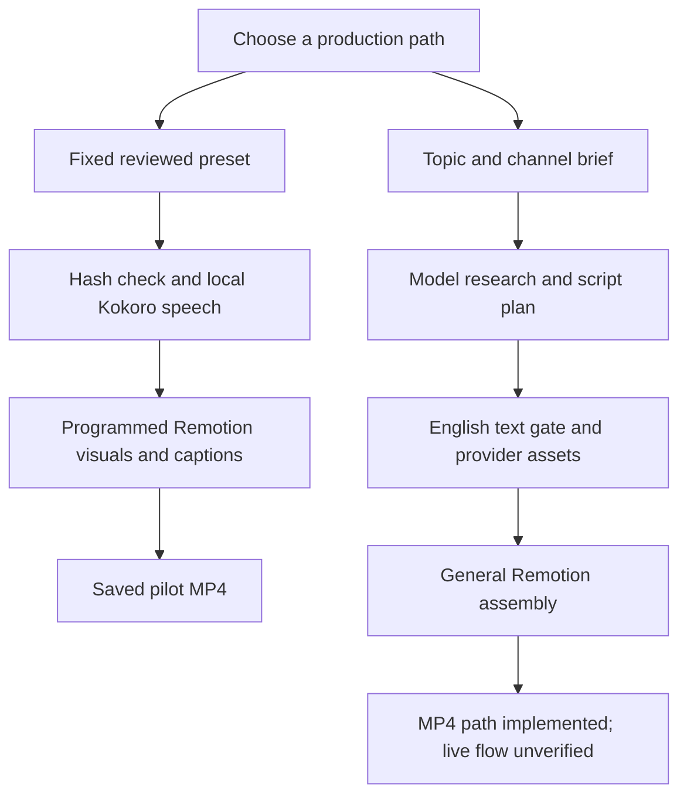
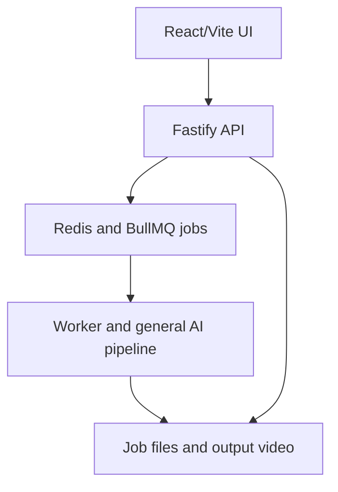

# OpenReels — audited architecture and handover

Audit date: 16 October 2026 (India). Intended reader: Alistair or a developer taking over. This document supersedes broad progress summaries where they conflict with the evidence below.

This is the audit-time architecture snapshot. Later verified video work is summarized in section 8 and linked by PROJECT_STATE.json; historical counts/next steps below are not the current milestone queue.

## 1. Verdict

**We have built a working, narrow video prototype—not an autonomous five-channel content business.** The strongest evidence is a saved English micro-drama rendered from a fixed script with local synthetic narration and programmed illustrated visuals. A broader inherited AI video pipeline exists in code, but its paid-provider and web-stack operation has not been validated end to end in this project.

The main reporting problem was blending working code, host-assisted work, downloaded research and future ideas into a single impression of an automated system. I should have kept those boundaries explicit. Tests establish software behavior; they do not establish natural acting, audience retention, revenue or production readiness.

## 2. Source of truth and branches

| Branch | Audited checkpoint | Meaning |
|---|---|---|
| `build/five-channel-starter` | `7d7224b67db3694dcd4b7f3708eff36c13621abf` | Preserved baseline: custom code, media, research and recovery record. |
| `experiment/video-quality` | `77687483cc0b6dbd735c6c08dc81e9a67b2a44c2` before this audit documentation | Copy for future work. At audit start, differed from baseline only in three documentation/memory files; no improved video or new integration. |
| `main` | `fa970d544ce039298a99ea1b049f234f2c1d3a1e` | Older application source plus manually added workflow entry points. Does not contain the custom free-pilot script. Do not assume main is our latest build. |

GitHub branch heads were queried, then fetched and inspected. The earlier experiment worktree path was missing in this session, despite the branch and commit surviving on GitHub. An audit checkout was restored at `/workspace/scratch/c946dce218e8/openreels-handover-audit`. Local workspace paths are transient; Git commits are the handover source. The copy is a branch in the same repository, not an independent repository or disaster-recovery backup. Original checkout had unrelated local media modifications; this audit did not overwrite or commit them.

## 3. What runs: two distinct paths



### A. Verified fixed-preset renderer — current working product

Entry: `node scripts/free-pilot.mjs --preset micro-drama`.

- Reads one of two checked-in scripts: productivity or micro-drama. **It does not accept an arbitrary topic or write new stories.** Script and visual-source SHA256 pins reject unreviewed edits before model download.
- Loads local CPU Kokoro 82M ONNX speech. Narration uses `af_bella` at 1.1; the closing question is a separate clip at 1.0 with a 550 ms pause and specific reviewed phonemes emphasizing “you.”
- Combines sentence clips and silence into scene WAVs and frame cues. These are clip-boundary timestamps, not word recognition or automatic emotion detection.
- Remotion renders original React/SVG-style phone, hallway, door and clock graphics. These are illustrated template scenes, not generated live-action actors. The current visuals have knock pulses; the free renderer adds no separate knock sound effect or background music track.
- Writes preview/stills, MP3 comparisons, render props, a report and H.264/AAC MP4 under `output/micro-drama/`. Checked-in examples preserve selected outputs; ignored output/cache folders do not automatically become backups.

Evidence: `scripts/free-pilot.mjs:17-23,28-76`; `src/free-pilot/policy.mjs:3-29`; `src/free-pilot/speech.mjs:1-26`; `src/free-pilot/micro-drama/Root.tsx:56-91`.

The English guard here is a **reviewed-content allowlist**, not a detector proving every sound or pixel is English. Hashes protect the script and Root source, not every dependency or every possible future metadata file. Updating hashes is a deliberate editorial review step, not a substitute for it. The program's zero-cost report fields are static declarations of this route, not independent billing telemetry. The inspected route contains no paid-provider calls, but first use can download model/browser assets and uses compute/storage. “No generation API charges” does not mean unlimited free resources.

### B. General AI pipeline — substantial code, separate validation status

Entry: `src/index.ts`; channel wrapper: `scripts/channel.mjs`. A topic and channel brief pass through research, creative direction/revisions, English text review, speech, image/video/music assets and Remotion assembly. Provider factory offers hosted services; local speech alone does not make the full route free.

Its `critic` grades the **DirectorScore JSON plan**, including the nominal post-render stage. It is not watching the MP4. Some critic errors are skipped and replay bypasses the final critic. The English gate examines narration and visual prompts before assets; it does not OCR the final video or transcribe the generated audio.

**Spending distinction:** the offline channel preview prints arguments without calls. The general pipeline's `--dry-run` still performs model work. Research, revisions and language review happen before asset-cost confirmation. The web worker automatically accepts cost estimates. Therefore no general-pipeline/API/worker execution is part of the currently authorized free-first path.

Evidence: `scripts/channel.mjs:31-54`; `src/agents/critic.ts:70-84`; `src/agents/english-only.ts:10-28`; `src/pipeline/orchestrator.ts:388,435,480-589,813-891`; `src/worker.ts:215-220`.

### C. Web application — present, not demonstrated as a deployed service



This is the inherited API/queue/worker architecture, not the fixed free renderer's UI. Docker Compose supplies the services and shared job files. No complete deployed UI-to-worker-to-paid-output demonstration was found in the project evidence. Evidence: `src/server.ts:262`; `src/worker.ts:99-136,271`; `web/src/hooks/useApi.ts:1-4`; `docker-compose.yml:1-39`.

## 4. Agents, skills and memory — what those words mean here

| Component | Actually present | Not established |
|---|---|---|
| Host agents | Chat-session agents used for research, code and sampled-frame review; project role instructions | A continuously running autonomous team, scheduler or published business service |
| Remotion/React skills | Checked-in development instructions with pinned source metadata | New video models or automatic runtime quality checks |
| Project memory | Manually maintained JSONL facts; explicit search/open via a local MCP stdio server | Global ChatGPT memory, automatic history import, unlimited context, guaranteed recall or hallucination prevention |
| Agent Reach | Downloaded external repository; source metadata and capability notes in this fork | Offline frame critique or audio/prosody review performed by Agent Reach |
| Three critique repositories | Adjacent research clones and written comparison | Installed integrations or successful critique of our episode |
| Qwen3-TTS, Qwen3-VL, WhisperX, Wan | Evaluated in research | Adopted/tested production upgrades |

Memory validates JSON structure and caps retrieval at 6,000 bytes; it does not validate the truth of a stored observation or measure token savings. Reading and updating facts remains an agent/developer responsibility. Evidence: `tools/agent-memory/memory.mjs:14-63`; `tools/agent-memory/package.json:6-9`; `docs/content-factory/AGENT_WORKFLOW.md:7-32`; `tools/agent-reach/SOURCE.json`; `VIDEO_IMPROVEMENT_RESEARCH.md`.

## 5. Actual media and fresh verification

Approved baseline: **The Message at Midnight**, under `examples/micro-drama/episode-01-question-revision/`.

- Fresh ffprobe: H.264 video, AAC audio, 720×1280, 30 fps; container duration **46.464 seconds**. Remotion composition/report duration is **46.4 seconds**; the small container difference is not evidence of a different episode.
- Fresh full FFmpeg decode: exit 0. Video size 3,557,883 bytes; SHA256 `9b438dff1eece70ea902c04921d6bdca61c90815288cc587bfb2ea6f2a3053c7`, matching the recorded approved video.
- Fresh software checks: **431 Vitest tests across 49 files + 23 Node tests = 454**, TypeScript passed; fixed-preset `--check` passed. Most Vitest tests cover the inherited application; the count is not 454 video-quality evaluations.
- This audit used existing installed dependencies through temporary links, not a clean dependency install, model regeneration or new Chromium render. Temporary links were removed after checks. Source checkout and media verification are reproducible independently of those links.
- GitHub API confirms [FREE English pilot run 38528230169](https://github.com/allywebspaces/OpenReels/actions/runs/38528230169) succeeded. Run head is main `fa970d5`; its workflow checks out source `558c0263911e9f578adf2c21a3a29a02d90d4555`. The workflow is pinned: pushing changes to the experiment branch alone will not make it render those changes. Artifacts have a seven-day retention setting; checked-in media is the durable copy.

Latest queried CI and Docker runs on main failed, while the free-pilot run succeeded. This audit did not investigate those failure causes. Do not report the entire repository CI/deployment as green.

## 6. Claims that need correcting

| Impression from earlier discussion | Evidence-based correction |
|---|---|
| “We built an autonomous five-channel system.” | Five briefs and launch configuration exist; the demonstrated route renders two fixed presets. Micro-drama is the current focus. No running five-channel operation exists. |
| “The agents review and improve the finished video automatically.” | Host agents performed sampled manual review. The inherited critic examines the plan. A recurring finished-video fix loop is pending. |
| “Every frame was reviewed.” | All 1,106 original frames were extracted; selected contact-sheet and full-resolution samples were reviewed. No claim of listening by those reviewers. |
| “454 checks prove video quality.” | They are software tests. User approval is subjective feedback; independent full listening, viewer testing and retention analysis remain absent. |
| “Memory prevents hallucinations and saves tokens.” | It can help retrieve curated facts; incorrect facts can persist. Savings were not measured. |
| “The new copy already contains quality upgrades.” | Before this audit it changed only three documentation/memory files. No alternate video, expressive model or aligned-word caption upgrade had been implemented. |
| “The name is available.” | Twist Harbor is a recommendation with no exact indexed match found, not confirmed handle availability or trademark clearance. |
| “Everything is production-ready/free.” | The fixed path works with no paid inference calls; other paths have provider/spending boundaries. No public channels, uploads, scheduling, analytics or monetization system is configured. |

The original progress documents mix historical phases. In particular, START_HERE still pointed first to the productivity pilot and STATUS had broad 'no review' wording alongside later sampled review. This handover and the updated checkpoint clarify current scope. Adjacent untracked local artifacts are not automatically part of a Git-backed handover.

## 7. Developer takeover and next work

Clone the actual working branch, not main:

```bash
git clone --branch experiment/video-quality https://github.com/allywebspaces/OpenReels.git
cd OpenReels
```

Use Node 24 and pnpm 11 for compatibility with the successful runner. Inspect `pnpm-workspace.yaml` for native-build policy. Install locked dependencies and FFmpeg; install the separate memory tool dependencies only if using it. A local full render additionally requires model downloads and supported Chromium. The prior local environment recorded a Chromium startup failure; the GitHub runner is the demonstrated rendering environment.

Safe first check after checkout needs no provider credentials or model download:

```bash
node scripts/free-pilot.mjs --preset micro-drama --check
```

For the separate test suites after dependencies are present:

```bash
node node_modules/vitest/vitest.mjs run
node --test scripts/channel.test.mjs scripts/github-pilot.test.mjs src/free-pilot/policy.test.mjs src/free-pilot/speech.test.mjs tools/agent-memory/memory.test.mjs
node node_modules/typescript/bin/tsc --noEmit
```

To render the reviewed preset, use `node scripts/free-pilot.mjs --preset micro-drama` only in a prepared environment. Do not use generic `pnpm start`, channel `--run`, general `--dry-run` or the paid English pilot workflow as free smoke tests. Do not copy keys into this public handover.

Recommended next milestone: one evidence-based, timestamped review of the approved episode, then one controlled alternative. Voice model audition, word alignment and three private pilot reviews remain subsequent experiments. Keep the original video and branch unchanged. Channel creation/public posting and paid inference remain on hold. The handover audit itself makes no new video-quality claim and no product-code changes.

## 8. Verified post-audit progress — 16 October 2026

The controlled visual alternative is archived under `examples/micro-drama/episode-01-visual-experiment/`, with approved AAC preserved. Qwen expressive voice audition was deferred after measured resource assessment, not performed. Episode02 The Folded Notes (sourceb549d2d/run38829602666) and episode03 The Waiting Room (sourced07fe39/run38845440707) rendered, decoded, hash-checked and sampled at21/18 actual-MP4 frames respectively. Their folders under examples/micro-drama preserve videos, exact WAVs, props and timestamped reviews. Together with approved episode01, the three-original-story target is ready_for_review; stop generating more content/features and pause continuation. See PRIVATE_PILOT_REVIEW.md and PROJECT_STATE.json. Four fixed renderer presets exist: productivity, micro-drama, emotional-drama and twist-drama. The episode01 alternative is not another story, and arbitrary-topic generation remains unsupported. New-pilot listening/final ASR/user approval, acted emotional delivery, audience response and launch are not verified. No paid inference, social account/publication or preserved-baseline change was authorized or made by these milestones.
