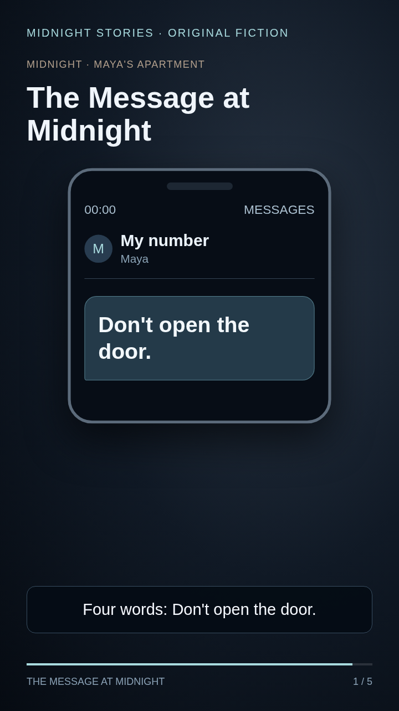

# Episode 01 — publication package

Creative approval recorded on 14 October 2026: user replied “looks good” after receiving the revised question and episode. This approves the creative revision; it does not authorize public posting.

## Title

She Got a Text From Her Own Number

## Description

At midnight, Maya receives a warning from her own number: Don't open the door. Then someone knocks.

Would you open it?

The Message at Midnight — an original fictional micro-drama. Illustrated visuals and synthetic English narration.

#MicroDrama #Mystery #ShortStory

## Instagram caption

A warning from her own number. A knock at midnight. Would you open it?

Original fiction: The Message at Midnight. Illustrated visuals and synthetic English narration.

#MicroDrama #Mystery #ShortStory

## Assets

- [Approved video](../episode-01-question-revision/pilot.mp4): 46.4 seconds, portrait 720×1280, English narration and captions.
- [Cover candidate](../episode-01-question-revision/review-scene-1.png): existing illustrated opening frame. No ending spoiler or fabricated true-story claim.
- [Structured package](package.json): copy-ready metadata and approved video checksum.

The title emphasizes the unusual sender; the cover adds the warning. These are creative choices, not measured click-through or earnings predictions. Midnight Stories remains a provisional series label. No paid generation calls or public uploads were made. Before uploading, select the destination account/channel and obtain explicit publication authorization; inspect its live disclosure and cover controls at that time.
